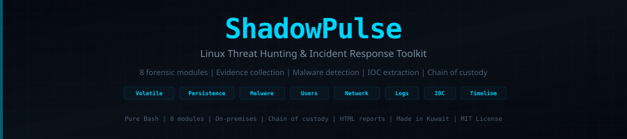

<div align="center">



<br>

[]()
[](LICENSE)
[]()
[]()
[]()

**Linux Threat Hunting and Incident Response Toolkit**

When a breach happens, the first 30 minutes determine everything.

[Quick Start](#quick-start) · [Modules](#modules) · [Usage](#usage) · [Output](#output) · [Contributing](#contributing)

</div>

---

## Overview

ShadowPulse automates the forensic investigation lifecycle on Linux systems. It collects volatile evidence, hunts for persistence mechanisms, detects malware and webshells, extracts IOCs, reconstructs event timelines, and generates chain-of-custody reports — all in a single execution.

### What It Does

- **Collects volatile evidence** before it disappears — processes, connections, memory maps, open files
- **Hunts persistence** — cron, systemd, shell profiles, SSH keys, LD_PRELOAD, init scripts
- **Detects malware** — webshell signatures (14 patterns), crypto miners, reverse shells, rootkit indicators
- **Audits users** — UID 0 accounts, passwordless users, NOPASSWD sudo, failed logins, SSH activity
- **Analyzes networks** — active connections, C2 port detection, DNS, ARP, firewall, promiscuous mode
- **Inspects logs** — brute force indicators, privilege escalation, log tampering detection
- **Extracts IOCs** — external IPs, domains, URLs, file hashes, suspicious command history
- **Builds timelines** — file modifications, auth events, package installations, login sessions
- **Preserves evidence** — SHA-256 hashing of every artifact for chain-of-custody integrity

### Design Principles

- **Zero dependencies** — Pure Bash. No Python, Ruby, Go, or external tools to install.
- **Forensically sound** — SHA-256 chain of custody for every evidence file collected.
- **Modular execution** — Run all 8 modules or select only what you need.
- **Non-destructive** — Read-only evidence collection. No system modifications.
- **On-premises** — Runs entirely on the target system. No data exfiltration.
- **Immediate deployment** — Download and execute. No compilation or configuration.

---

## Quick Start

```bash
# Deploy and run (full investigation)
curl -sO https://raw.githubusercontent.com/SiteQ8/ShadowPulse/main/shadowpulse.sh
chmod +x shadowpulse.sh
sudo ./shadowpulse.sh

# Or clone and run
git clone https://github.com/SiteQ8/ShadowPulse.git
cd ShadowPulse
sudo ./shadowpulse.sh
```

---

## Modules

| Module | Name | What It Collects and Detects |
|--------|------|-----|
| **01** | Volatile Data | Process trees, open file descriptors, deleted-but-open files, kernel modules, memory maps, environment variable secrets |
| **02** | Persistence Hunting | Cron (system + per-user), systemd services/timers, init scripts, rc.local, shell profiles (.bashrc/.profile), SSH authorized_keys, LD_PRELOAD hijacking, at jobs |
| **03** | Malware Detection | Hidden files (/tmp, /dev/shm), SUID audit, webshell signatures (14 patterns including c99, r57, WSO, b374k), crypto miners (xmrig, stratum), reverse shells, rootkit indicators, package integrity (rpm -Va / dpkg --verify), recently modified system binaries |
| **04** | User Analysis | UID 0 accounts, passwordless users, NOPASSWD sudo rules, login history (last/lastb), SSH accepted/failed counts, recently created users |
| **05** | Network Forensics | Active connections with process mapping, C2 port detection (4444/5555/1337/31337), DNS config audit, ARP table, routing, iptables/nftables, promiscuous mode |
| **06** | Log Analysis | Auth/syslog/kernel/web server logs, log tampering detection (empty/truncated), brute force counting, privilege escalation attempts, audit log extraction |
| **07** | IOC Extraction | External IPs (connections + logs), domain extraction, URL harvesting, SHA-256 hashes of suspicious files, shell history pattern matching (wget\|bash, base64 decode, /dev/tcp) |
| **08** | Timeline | File modification timeline (72 hours), authentication events, package installation history, login session timeline |

---

## Usage

```
sudo shadowpulse.sh [OPTIONS]

Modules:
  --all              Run all modules (default)
  --volatile         Volatile data collection
  --persistence      Persistence mechanism hunting
  --malware          Malware and webshell detection
  --users            User and authentication analysis
  --network          Network forensics
  --logs             Log analysis and anomaly detection
  --ioc              IOC extraction
  --timeline         Event timeline reconstruction

Options:
  --output DIR       Custom output directory
  --quiet            Suppress banner and progress
  --no-report        Skip HTML report generation
  --help             Show help
  --version          Show version
```

### Examples

```bash
# Full investigation — all 8 modules
sudo ./shadowpulse.sh

# Threat hunting — focus on malware and persistence
sudo ./shadowpulse.sh --malware --persistence

# Network incident — connections and IOCs
sudo ./shadowpulse.sh --volatile --network --ioc

# Brute force investigation — users and logs
sudo ./shadowpulse.sh --users --logs --timeline

# Case management — custom output path
sudo ./shadowpulse.sh --output /cases/INC-2026-042

# Quiet mode — CI/CD or automated pipelines
sudo ./shadowpulse.sh --quiet --no-report
```

---

## Output

Every investigation produces a forensic evidence package:

```
/var/shadowpulse/case-YYYYMMDD-HHMMSS/
├── evidence/                     # 50+ raw evidence artifacts
│   ├── processes-tree.txt        # Process hierarchy
│   ├── deleted-files-open.txt    # Deleted but open files
│   ├── cron-system.txt           # System cron jobs
│   ├── cron-users.txt            # Per-user cron jobs
│   ├── systemd-services.txt      # All systemd units
│   ├── ssh-authorized-keys.txt   # SSH public keys
│   ├── webshells-*.txt           # Detected webshell files
│   ├── suid-binaries.txt         # SUID/SGID audit
│   ├── netstat-established.txt   # Active connections
│   ├── ioc-ips.txt               # External IP addresses
│   ├── ioc-hashes.txt            # SHA-256 file hashes
│   ├── timeline-files.txt        # File modification timeline
│   └── ...
├── chain-of-custody.sha256       # SHA-256 of every evidence file
└── report.html                   # Visual forensic report
```

### Chain of Custody

Every evidence file is SHA-256 hashed immediately after collection. The `chain-of-custody.sha256` file provides cryptographic proof that evidence has not been modified after collection — essential for legal proceedings and compliance audits.

### HTML Report

The forensic report includes an executive summary with severity-scored findings (Critical/High/Medium/Low), remediation guidance for every finding, evidence file listing, and case metadata (hostname, kernel, timestamp, investigator).

---

## Detections

### Persistence (Module 2)

| Detection | Severity | Technique |
|-----------|----------|-----------|
| Cron with curl/wget/nc/base64 | CRITICAL | Scheduled download and execute |
| Shell profile injection | CRITICAL | .bashrc/.bash_profile code injection |
| LD_PRELOAD hijacking | CRITICAL | Library injection via /etc/ld.so.preload |
| SSH root login enabled | HIGH | PermitRootLogin yes |
| Active rc.local commands | HIGH | Init-level persistence |
| Recently modified systemd services | MEDIUM | Service file tampering (7-day window) |

### Malware (Module 3)

| Detection | Severity | Indicators |
|-----------|----------|------------|
| Webshells (14 signatures) | CRITICAL | eval(base64_decode), system($_), c99shell, r57shell, WSO, b374k, FilesMan, AnonymousFox |
| Crypto miners | CRITICAL | xmrig, minerd, cpuminer, stratum, cryptonight |
| Reverse shells | CRITICAL | bash -i, /dev/tcp, nc -e, python socket |
| Hidden process (rootkit) | CRITICAL | /proc PID without matching ps entry |
| Modified system binaries | HIGH | /usr/bin, /sbin changes in 24 hours |
| Deleted-but-open files | HIGH | Malware evasion via file deletion |
| Unusual SUID binaries | HIGH | SUID outside standard paths |

### Network (Module 5)

| Detection | Severity | Indicators |
|-----------|----------|------------|
| C2 port connections | CRITICAL | Outbound to 4444, 5555, 6666, 1337, 31337 |
| No firewall rules | HIGH | No DROP/REJECT in iptables or nftables |
| Promiscuous mode | HIGH | Network interface sniffing |
| Non-standard DNS | MEDIUM | DNS servers outside known providers |

---

## Disclaimer

ShadowPulse is designed for authorized incident response and forensic investigations on systems you own or have explicit written authorization to investigate. Running this tool on systems without authorization may violate applicable laws. Evidence collection is read-only and non-destructive.

---

## Contributing

Contributions welcome:

- Additional malware signatures and detection patterns
- Cloud-specific forensic modules (AWS, Azure, GCP)
- Container forensics (Docker, Kubernetes)
- Memory acquisition integration
- YARA rule integration
- STIX/TAXII IOC export format

See [CONTRIBUTING.md](CONTRIBUTING.md).

---

## License

MIT License — see [LICENSE](LICENSE).

---

<div align="center">
  <sub>ShadowPulse — Linux Threat Hunting and Incident Response Toolkit</sub><br>
  <sub><a href="https://github.com/SiteQ8">@SiteQ8</a> — Ali AlEnezi — Made in Kuwait</sub>
</div>
